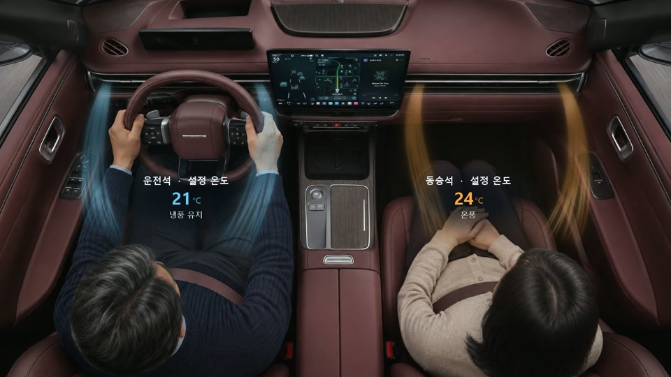
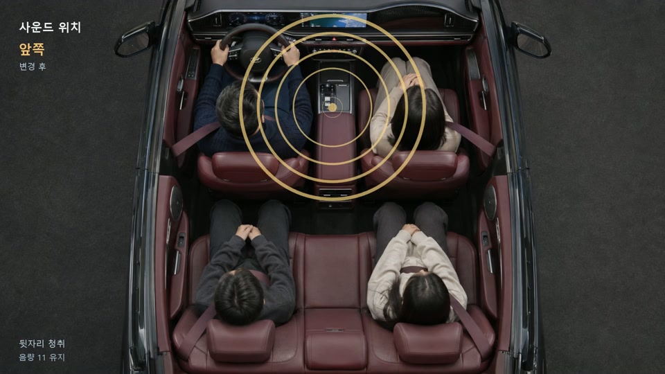
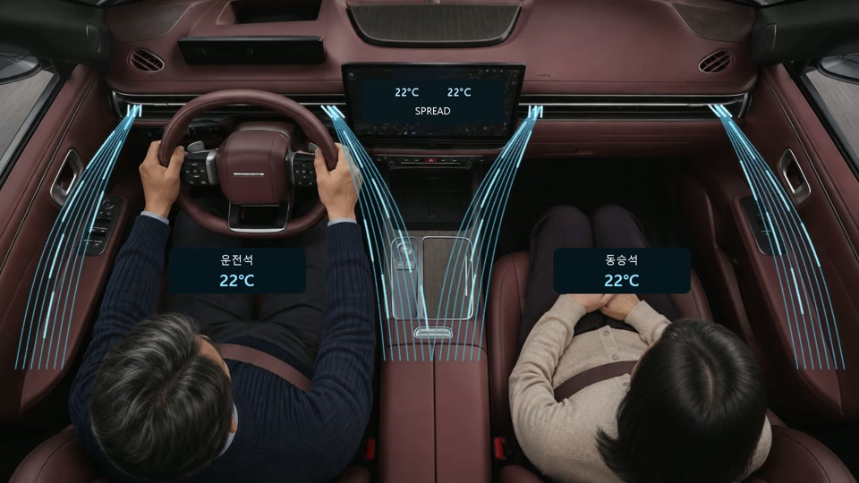
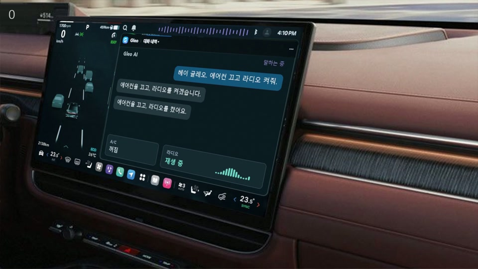

# 내 차 사용 안내

**몰랐던 차량 기능을, 필요한 순간의 짧은 체험으로 익히는 Pleos Connect 차량용 앱입니다.** 기능의 이름을 설명하는 데서 시작하기보다 사용자의 불편을 기능 발견·체험·다음 사용으로 연결합니다.

[① 다섯 가지 고객 경험](#다섯-가지-고객-경험) → [② 실제 APK 실행과 검증](#실제-apk-실행과-검증) → [③ 코드 구조](docs/architecture.md)

## 다섯 가지 고객 경험

먼저 아래 영상으로 사용 장면을 살펴보세요. 총 약 **6분 21초**입니다. 썸네일이나 **영상 열기**를 누르면 MP4가 열리거나 다운로드됩니다. 저장소와 영상은 **비공개**이므로 접근 권한이 있는 GitHub 로그인이 필요합니다.

다섯 편은 **제품 경험 시나리오**를 표현한 영상입니다. 각 항목의 **현재 APK**와 아래 실구동 검증에서 실제 구현 범위를 확인할 수 있습니다.

| 영상 | 사용 장면 → 체험 → 구현 근거 |
|---|---|
| [](https://github.com/changseokmid-cell/pleos-tutorial/releases/download/contest-five-feature-videos-20261114/01_SYNC_339b0091.mp4)<br>**01 · 좌석별 독립 온도 · SYNC · 0:48** | **운전자는 더운데, 동승자는 춥다면?**<br>운전석 온도는 유지하고 동승석만 따뜻하게 바꾸며 좌석별 독립 조절을 발견합니다.<br>**현재 APK:** 실제 SDK 제어·재조회 확인: 운전석 21°C 유지 / 동승석 24°C.<br>[▶ 영상 열기](https://github.com/changseokmid-cell/pleos-tutorial/releases/download/contest-five-feature-videos-20261114/01_SYNC_339b0091.mp4) · [장면 설명](demos/README.md#sync) · [관련 코드](https://github.com/changseokmid-cell/pleos-tutorial/blob/4fe8a913b52770218757791bf1749c2fb8b35ef9/android/app/src/main/java/kr/pleosguide/VehicleContextRepository.kt#L147) · [검증 근거](demos/README.md#sync-evidence) |
| [](https://github.com/changseokmid-cell/pleos-tutorial/releases/download/contest-five-feature-videos-20261114/02_ERGO_c248edc4.mp4)<br>**02 · 에르고 시트 스트레칭 · 2:01** | **오래 앉아 뻐근할 때, 몰랐던 시트 버튼을 발견합니다.**<br>휴게소에서 버튼 위치와 모드 순서를 익히고, 다음 정차 때 스스로 다시 사용합니다.<br>**현재 APK:** 시트 버튼·모드 안내와 응답 기록. 스트레칭 모터 직접 제어 없음.<br>[▶ 영상 열기](https://github.com/changseokmid-cell/pleos-tutorial/releases/download/contest-five-feature-videos-20261114/02_ERGO_c248edc4.mp4) · [장면 설명](demos/README.md#ergo) · [관련 코드](https://github.com/changseokmid-cell/pleos-tutorial/blob/4fe8a913b52770218757791bf1749c2fb8b35ef9/android/app/src/main/java/kr/pleosguide/TutorialCoordinator.kt#L151) · [검증 근거](demos/README.md#ergo-evidence) |
| [](https://github.com/changseokmid-cell/pleos-tutorial/releases/download/contest-five-feature-videos-20261114/03_SOUND_9fc8ab12.mp4)<br>**03 · 사운드 위치 · 1:21** | **뒷자리에서는 음악이 너무 크게 들린다면?**<br>같은 음량에서 소리의 중심을 앞쪽으로 옮겨 체험하고, 휴식 뒤 직접 가운데로 되돌립니다.<br>**현재 APK:** 순정 위치 설정 안내와 복원 응답 기록. 스피커 직접 제어 없음.<br>[▶ 영상 열기](https://github.com/changseokmid-cell/pleos-tutorial/releases/download/contest-five-feature-videos-20261114/03_SOUND_9fc8ab12.mp4) · [장면 설명](demos/README.md#sound) · [관련 코드](https://github.com/changseokmid-cell/pleos-tutorial/blob/4fe8a913b52770218757791bf1749c2fb8b35ef9/android/app/src/main/java/kr/pleosguide/TutorialCoordinator.kt#L152) · [검증 근거](demos/README.md#sound-evidence) |
| [](https://github.com/changseokmid-cell/pleos-tutorial/releases/download/contest-five-feature-videos-20261114/04_SPREAD_abd18197.mp4)<br>**04 · 직풍 피하기 · SPREAD · 1:01** | **시원한 온도는 좋은데, 얼굴에 바람이 직접 닿는다면?**<br>온도를 높이는 대신 바람을 분산하는 기능을 체험하고 다음에 선택할 방법을 익힙니다.<br>**현재 APK:** 순정 메뉴 안내와 목표온도 유지 관측. 전동 벤트 제어·모드 확인 없음.<br>[▶ 영상 열기](https://github.com/changseokmid-cell/pleos-tutorial/releases/download/contest-five-feature-videos-20261114/04_SPREAD_abd18197.mp4) · [장면 설명](demos/README.md#spread) · [관련 코드](https://github.com/changseokmid-cell/pleos-tutorial/blob/4fe8a913b52770218757791bf1749c2fb8b35ef9/android/app/src/main/java/kr/pleosguide/TutorialCoordinator.kt#L153) · [검증 근거](demos/README.md#spread-evidence) |
| [](https://github.com/changseokmid-cell/pleos-tutorial/releases/download/contest-five-feature-videos-20261114/05_GLEO_9aca15d5.mp4)<br>**05 · Gleo 복합 요청 · 1:10** | **에어컨과 라디오를 각각 조작하고 있었다면?**<br>두 가지 부탁을 한 문장으로 전달하는 방법을 배우고, 운전자가 직접 Gleo를 호출합니다.<br>**현재 APK:** App Schema 3개 action·callback 전송 확인. 실제 Gleo 음성 왕복은 추후 시험.<br>[▶ 영상 열기](https://github.com/changseokmid-cell/pleos-tutorial/releases/download/contest-five-feature-videos-20261114/05_GLEO_9aca15d5.mp4) · [장면 설명](demos/README.md#gleo) · [관련 코드](https://github.com/changseokmid-cell/pleos-tutorial/blob/4fe8a913b52770218757791bf1749c2fb8b35ef9/android/app/src/main/java/kr/pleosguide/GleoReceiver.kt#L10) · [검증 근거](demos/README.md#gleo-evidence) |

[최신 영상 5개 한곳에서 받기](https://github.com/changseokmid-cell/pleos-tutorial/releases/tag/contest-five-feature-videos-20261114) · [버전·해시·썸네일 출처](demos/media-manifest.json)

에르고는 **revision-3**, 사운드는 **위치 중심 v5**입니다. 최신 사운드 영상은 음장 비교를 포함하지 않습니다. 이전 영상과 기존 APK 검증 Release는 보존합니다.

## 실제 APK 실행과 검증

[](https://github.com/changseokmid-cell/pleos-tutorial/releases/download/contest-round1-verified-20261114/Release_Emulator.mp4)

**[▶ 실제 서명 APK 녹화 · 2분 7초](https://github.com/changseokmid-cell/pleos-tutorial/releases/download/contest-round1-verified-20261114/Release_Emulator.mp4)** · [서명 APK·소스 ZIP 받기](https://github.com/changseokmid-cell/pleos-tutorial/releases/tag/contest-round1-verified-20261114)

실제 Pleos 에뮬레이터 화면입니다. 녹화는 무음이며 수락·체감 버튼은 자동 UI 입력입니다. 다섯 시나리오의 영화와 별도로, 아래 결과를 확인했습니다.

| 확인할 내용 | 실행 근거 |
|---|---|
| SYNC 해제, 운전석 21°C 유지 / 동승석 24°C 설정 | [명령·독립 재조회 로그](evidence/release-smoke-verified/evidence.jsonl), [전체 UI 시험 PASS](evidence/release-smoke-verified/run.json) |
| Off 후 조회 중단, 앱 재실행·콜드 부팅·강제 종료 후 기본 Off | [재시작 검사](evidence/restart-persistence/run.json) |
| 표시 이력과 다섯 기능 설정 유지 | [재시작 후 화면](evidence/restart-persistence/04-killed-while-on-history.png), [전후 값 비교](evidence/restart-persistence/run.json) |
| 에르고·사운드·SPREAD 안내, Gleo action 수신부 | [기능별 코드·증거 안내](demos/README.md), [전체 시험 범위](docs/testing.md) |

실제 사람의 STT 발화와 순정 Gleo 자연어 왕복은 추후 시험입니다. 영화의 체감·재사용 장면이나 자동화 응답을 사용자 학습 효과의 검증으로 해석하지 않습니다.

## 이어서 읽기

[심사 안내](docs/reviewer-guide.md) · [3쪽 작품 소개 PDF](docs/proposal-public.pdf) · [코드 구조와 함수별 읽기](docs/architecture.md) · [현재 APK 구현표](docs/implementation.md) · [재현 절차](docs/testing.md)

## 코드의 핵심

- [TutorialCoordinator.kt](android/app/src/main/java/kr/pleosguide/TutorialCoordinator.kt): 한 번에 한 체험, 제안·수락·실행·피드백·취소를 조정합니다.
- [VehicleContextRepository.kt](android/app/src/main/java/kr/pleosguide/VehicleContextRepository.kt): 지원성과 최신 차량 값을 읽고 명령 접수와 결과 재조회를 구별합니다.
- [Models.kt](android/app/src/main/java/kr/pleosguide/Models.kt): 값의 출처·시각·지원성, 안전 조건과 세션 상태를 정의합니다.
- [Stores.kt](android/app/src/main/java/kr/pleosguide/Stores.kt): 초기화할 실행 상태와 보존할 설정·체험 기록을 분리합니다.

화면·서비스·음성·Gleo의 역할과 읽을 함수는 [코드 안내](docs/architecture.md)에서 이어집니다. 검증한 Android 소스와 APK를 유지하면서 문서의 설명 순서와 코드 탐색 경로를 재구성했습니다.

## 빌드와 실행

패키지 `kr.pleosguide`, 버전 `1.0.0`. JDK 17, Android SDK Platform 35 / Build Tools 35.0.0 및 Maven 접근이 필요합니다. Gradle 8.9 Wrapper를 포함하고 SDK AAR·서명키는 포함하지 않습니다.

```powershell
$env:JAVA_HOME = 'C:/path/to/jdk-17'
$env:ANDROID_HOME = 'C:/path/to/android-sdk'
./tools/build.ps1
```

Windows 출력은 `%LOCALAPPDATA%/PleosSyncLab/tutorial-build/outputs/apk/debug/app-debug.apk`입니다. 한글 경로의 JUnit 클래스 로딩 문제를 피하도록 빌드 출력만 ASCII 경로에 둡니다. Linux/macOS는 `android/`에서 `bash ./gradlew :app:assembleDebug :app:testDebugUnitTest`를 사용할 수 있으나 이번 실행 검증은 Windows에서 했습니다.

서명 빌드는 외부 keystore alias `submission`과 `PLEOS_KEYSTORE`, `PLEOS_STORE_PASSWORD`, `PLEOS_KEY_PASSWORD` 환경 변수를 설정해 `./tools/build.ps1 -Release`로 실행합니다. 키·암호는 저장소에 넣지 않습니다.

```text
adb -s emulator-5572 install apk/PleosTutorial-1.0.0.apk
adb -s emulator-5572 shell am start --user current -n kr.pleosguide/.MainActivity
```

검증 환경은 Pleos Connect 2.1.0 / API 34입니다. 일반 휴대전화에는 차량 서비스가 없습니다. 앱에서 튜토리얼을 켜고 P 상태에서 체험을 선택합니다. [DDS 준비 확인과 재현 명령](docs/testing.md)을 먼저 읽어 주세요. Android 부팅 완료와 차량 서비스 준비 완료는 다른 시점일 수 있습니다.

## 증거·버전·후속 과제

[서명 release 실행 기록](evidence/release-smoke-verified/run.json), [재시작 검사](evidence/restart-persistence/run.json), [DDS 복구 기록](docs/dds-recovery.md)이 이번 검증을 설명합니다. 이전 실패와 [첫 후보 Release](https://github.com/changseokmid-cell/pleos-tutorial/releases/tag/contest-round1-candidate-20261114)는 보존합니다.

APK Android 소스 기준은 `4fe8a913b52770218757791bf1749c2fb8b35ef9`이며 [빌드 검증 기록](evidence/build/release-audit.json)에 연결됩니다. 검증 Release의 `submission-manifest.json`은 문서·도구·증거를 포함한 최종 commit과 APK·ZIP·영상 해시를 연결합니다.

고정 검증본 commit은 `aacb5a1f78ae43a34a8beaa64c65964f996801f0`입니다. [업로드 검증 기록](docs/github-storage-verified.json)에 8개 첨부파일의 서버 SHA-256 일치와 APK·제출 ZIP 재다운로드 대조를 남겼습니다. 이후 브랜치의 보관 기록 commit은 고정 ZIP과 구별합니다.

실제 음성/Gleo, 장시간 주행 후 제안, 실차 사양별 지원, 사용자 학습·재사용 효과는 후속 검증입니다. [현재 상태](DEV_STATE.md), [제출 절차](docs/submission.md), [개발 계획](docs/proposal-public.md)을 참고하세요.
