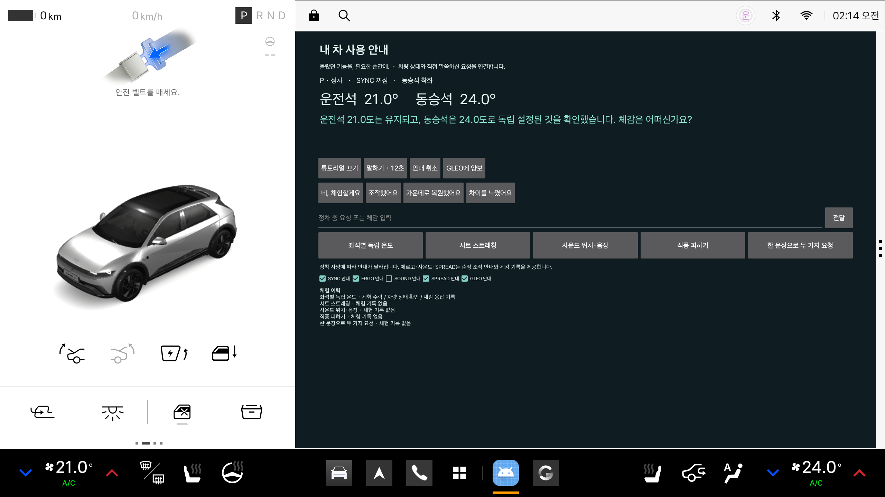

# 내 차 사용 안내

**차량에 탑재됐지만 몰랐던 기능을, 필요한 순간에 체험하고 스스로 사용하도록 돕는 Pleos Connect 차량용 튜토리얼 앱입니다.**

[① 기획 배경](#왜-이-앱이-필요한가) → [② 튜토리얼 모드의 경험](#튜토리얼-모드를-켜면) → [③ 영상 5개](#다섯-가지-고객-경험) → [④ 실제 APK 검증](#실제-apk-실행과-검증) → [⑤ 코드 구조](docs/architecture.md)

## 왜 이 앱이 필요한가

**현대자동차의 SDV 전환에는 차량의 발전과 함께 고객의 적응을 지원해야 하는 과제가 있습니다.**

현대자동차는 Pleos를 통해 차량을 구매 이후에도 기능과 서비스가 계속 발전하는 제품으로 전환하고 있습니다. 대화면 인터페이스, 음성 AI, 앱 생태계와 지속적인 업데이트는 이 전략을 실현하는 핵심 수단입니다. 현대차가 추진하는 미래 경쟁력의 방향이기도 합니다. [현대차그룹의 Pleos 설명](https://www.hyundaimotorgroup.com/ko/story/pleos-connect-next-generation-infotainment-system)

그런데 이 변화를 처음부터 받아들여야 하는 고객이 모두 새로운 디지털 환경에 익숙한 것은 아닙니다. Pleos가 처음 적용된 그랜저의 주요 구매층에는 50·60대가 자리하고 있습니다. 실제로 2026년 6월 신형 그랜저의 개인 구매자는 50대, 60대 순으로 많았습니다. 오랜 운전 경험이 있어도 새로운 화면 메뉴와 음성 AI의 활용 방법까지 자연스럽게 익히는 것은 아닙니다. [신형 그랜저 구매자 분석](https://v.daum.net/v/20260710220000831)

**우리는 고객을 더 편리하게 만들기 위한 차량의 발전이, 디지털 조작에 익숙하지 않은 핵심 고객에게는 계속 새로운 것을 배워야 하는 부담으로 다가올 수 있다는 역설에 주목했습니다.**

현대차가 기능과 서비스를 고도화하는 동안, 사용자는 무엇이 추가됐는지 확인하고, 자신에게 필요한 기능을 찾아내고, 달라진 조작 방법을 익혀야 합니다. 이 과정을 사용자의 자발적인 탐색과 학습에 맡긴다면 디지털 활용에 어려움을 겪는 고객일수록 차량의 발전에서 얻을 수 있는 혜택을 충분히 누리기 어려워집니다.

사용 설명서와 업데이트 안내만으로 이 간격을 메우기는 어렵습니다. 소비자가 방대한 설명서를 모두 읽고 기억하거나, 업데이트마다 변경 사항을 확인해 자신의 생활에 적용하기를 기대하기는 어렵기 때문입니다. 음성 AI가 자연스러운 요청을 이해하더라도, 사용자가 **“내 차가 이런 상황에서 이런 도움까지 줄 수 있다”**는 사실을 떠올리지 못하면 활용으로 이어지지 않을 수 있습니다.

이 문제는 소비자의 불편에 그치지 않습니다. 현대차가 개발하고 제공한 기능이 사용되지 않으면, 기술 투자와 업데이트의 성과가 고객이 체감하는 가치로 충분히 전달되기 어렵습니다. 차량에는 더 많은 기능이 생겼지만 고객은 이전과 같은 기능만 사용하는 상황에서는 SDV의 발전을 구매 이후의 만족과 지속적인 서비스 이용으로 연결하기 어렵습니다.

**따라서 SDV 전환에는 새로운 기능을 제공하는 것과 함께, 기존 고객이 그 기능을 발견하고 익히도록 돕는 과정이 필요합니다.** ‘내 차 사용 안내’는 이 과정을 지원하기 위해 제안하는 앱입니다. 초기 대상은 **Pleos 탑재 그랜저를 새로 이용하는 50~69세 운전자 중, 새로운 디지털 조작과 기능 탐색에 어려움을 겪는 사람**입니다.

<details>
<summary>고객 정의와 근거를 읽는 기준</summary>

그랜저 구매자 자료는 2026년 6월 개인 구매자에 관한 것으로 현대차 전체 고객의 연령 구성을 뜻하지 않습니다. [NIA의 2025 디지털정보격차 실태조사](https://www.nia.or.kr/site/nia_kor/ex/bbs/View.do?bcIdx=29168&cbIdx=81623)는 일반 국민 대비 55세 이상 고령층 전체의 디지털정보화 역량을 56.2%로 보고하며, 연령별 차이도 제시합니다. 

</details>

## 튜토리얼 모드를 켜면

**우리가 지향하는 경험은 모드를 켜고 평소처럼 차량을 이용하는 동안, 필요한 기능을 한 번 경험하고 다음에는 스스로 쓰게 되는 것입니다.** 안내는 기존 차량 화면과 짧은 음성 안에서 필요한 순간에 이어지도록 설계합니다.

| 흐름 | 사용자가 기대할 수 있는 경험 |
|---|---|
| **1. 모드를 켭니다** | 체험할 기능과 허용 범위를 정하고 평소처럼 차량을 이용합니다. |
| **2. 도움이 될 순간을 찾습니다** | 앱이 백그라운드에서 차량에서 확인할 수 있는 상태와 사용자가 전달한 요청을 바탕으로 필요한 기능을 연결합니다. |
| **3. 실제 효과를 경험합니다** | 차량의 지원·안전 조건과 허용 범위에 따라 기능 작동을 체험하거나 실제 조작 방법을 안내받습니다. |
| **4. 변화의 이유를 이해합니다** | 무엇이 달라졌고 어떤 기능이 그 변화를 만들었는지, 다음에는 언제 어떻게 쓰는지 짧게 안내받습니다. |
| **5. 다음에는 직접 사용합니다** | 비슷한 상황에서 기능을 떠올리고 스스로 선택할 수 있도록 돕습니다. 이것이 체험을 통해 기대하는 학습 결과입니다. |

상황 인식과 자동 실행은 이 학습 경험을 만드는 수단입니다. 앱의 목표는 사용자가 **기능의 존재 → 자신의 상황에서의 쓰임 → 다시 사용하는 방법**을 연결해 이해하도록 돕는 것입니다. 이후에는 업데이트로 추가·변경된 기능도 실제 사용 상황에서 익히도록 확장하고자 합니다.

예를 들어 운전자는 더운데 동승자는 추운 상황에서, 운전석은 21°C를 유지하면서 동승석만 24°C로 바뀌는 효과를 경험합니다. 그때 좌석별 독립 온도 조절 기능과 사용 방법을 안내합니다. 다음에 같은 상황이 생겼을 때 **“전체 온도를 바꾸기 전에 동승석만 조절할 수 있겠구나”**라고 떠올리는 것이 목표입니다.

> **현재 시제품과의 연결:** 위 흐름은 제품이 지향하는 경험입니다. 현재 APK는 정차(P) 및 차량 UX 허용 조건의 상세 체험과 일부 차량 제어를 구현했습니다. 주행 중 선제 안내·업데이트 연동·사용자의 학습 효과는 후속 검증·개발 대상이며, 실제 구현·검증 결과는 아래 기능별 **현재 APK**와 [실구동 검증](#실제-apk-실행과-검증)에서 확인할 수 있습니다.

## 다섯 가지 고객 경험

차에 어떤 기능이 있는지 모르면, 그 기능이 필요한 순간에도 익숙한 방법만 사용하게 됩니다. ‘내 차 사용 안내’는 바로 그 순간을 기능을 발견하고 배우는 기회로 연결합니다.

아래 다섯 영상은 **기능의 존재를 몰랐던 고객이 자신의 상황에서 효과를 경험하고, 다음에는 스스로 사용할 방법을 알아가는 과정**을 보여줍니다.

썸네일이나 **영상 열기**를 누르면 MP4가 열리거나 다운로드됩니다. 다섯 편은 **제품 경험 시나리오**를 표현한 영상입니다. 각 표의 **현재 구현과 검증 보기**를 펼치면 현재 APK의 구현 범위·관련 코드·검증 근거를 확인할 수 있습니다.

<table>
<tr><td>
<h3>01. 좌석마다 온도를 다르게 맞출 수 있다는 걸 모릅니다.</h3>
<p><em>좌석별 독립 온도 · SYNC｜48초</em></p>
<p>이 영상의 고객은 운전석과 동승석의 온도를 따로 설정할 수 있다는 사실을 모릅니다. 누군가 덥거나 춥다고 하면, 익숙한 온도 조절로 두 사람에게 맞는 하나의 온도를 찾으려 합니다.</p>
<p align="center"><a href="https://github.com/changseokmid-cell/pleos-tutorial/releases/download/contest-five-feature-videos-20261115/01_SYNC_17e9fe22.mp4"></a><br><a href="https://github.com/changseokmid-cell/pleos-tutorial/releases/download/contest-five-feature-videos-20261115/01_SYNC_17e9fe22.mp4">▶ 영상 열기 · 0:48</a></p>
<ul>
<li><strong>체험의 계기</strong> — 더운 운전자가 온도를 낮추자 동승자는 추위를 느낍니다. 튜토리얼은 두 사람의 서로 다른 요구가 드러난 순간, 동승석만 따뜻하게 조절하는 방법을 소개합니다.</li>
<li><strong>경험하며 알게 되는 점</strong> — 운전석은 21°C를 유지하고 동승석만 24°C로 바뀝니다. 두 사람이 각자 편안해지는 경험을 통해 <strong>“내 차는 좌석마다 온도를 다르게 맞출 수 있구나”</strong>라고 이해합니다.</li>
<li><strong>다음에 기대하는 행동</strong> — 동승자가 춥다고 할 때 전체 온도부터 바꾸던 습관에서, 필요한 좌석의 온도를 따로 조절하는 선택으로 이어집니다.</li>
</ul>
<details>
<summary>현재 구현과 검증 보기</summary>
<p><strong>현재 APK:</strong> 실제 SDK 제어·재조회로 운전석 21°C 유지 / 동승석 24°C를 확인했습니다. 시험은 P 및 차량 UX 허용 조건에서 자동 UI 수락으로 진행했습니다. 영상의 주행·음성 장면과 이후 학습 효과는 이 시험의 검증 범위에 포함되지 않습니다.</p>
<p><a href="demos/README.md#sync">장면 설명</a> · <a href="https://github.com/changseokmid-cell/pleos-tutorial/blob/4fe8a913b52770218757791bf1749c2fb8b35ef9/android/app/src/main/java/kr/pleosguide/VehicleContextRepository.kt#L147">관련 코드</a> · <a href="demos/README.md#sync-evidence">검증 근거</a></p>
</details>
</td></tr>
</table>

<table>
<tr><td>
<h3>02. 시원함을 유지하면서 몸에 직접 닿는 바람을 피할 수 있다는 걸 모릅니다.</h3>
<p><em>직풍 피하기 · SPREAD｜1분 1초</em></p>
<p>차 안의 온도는 적당하지만 얼굴에 직접 닿는 바람이 불편합니다. 바람을 탑승자 주변으로 분산하는 기능을 모르기 때문에, 평소 익숙한 온도 조절로 해결하려 합니다.</p>
<p align="center"><a href="https://github.com/changseokmid-cell/pleos-tutorial/releases/download/contest-five-feature-videos-20261115/02_SPREAD_abd18197.mp4"></a><br><a href="https://github.com/changseokmid-cell/pleos-tutorial/releases/download/contest-five-feature-videos-20261115/02_SPREAD_abd18197.mp4">▶ 영상 열기 · 1:01</a></p>
<ul>
<li><strong>체험의 계기</strong> — 운전자가 “바람이 얼굴로 오니 온도를 올릴까?”라고 말하고, 동승자는 지금의 시원함을 유지하고 싶어 합니다. 튜토리얼은 이 대화에서 드러난 직풍의 불편에 맞춰 SPREAD 기능을 소개합니다.</li>
<li><strong>경험하며 알게 되는 점</strong> — 설정 온도는 그대로인 상태에서 바람이 몸 주변으로 퍼지는 변화를 경험합니다. <strong>온도와 바람의 방향을 각각 조절할 수 있으며, 시원함을 유지하면서도 직풍을 피할 수 있다</strong>는 것을 알게 됩니다.</li>
<li><strong>다음에 기대하는 행동</strong> — 비슷한 불편을 느낄 때 공조 화면에서 SPREAD를 직접 선택합니다. 불편의 원인에 맞는 기능을 떠올릴 수 있게 됩니다.</li>
</ul>
<details>
<summary>현재 구현과 검증 보기</summary>
<p><strong>현재 APK:</strong> 순정 메뉴 안내와 목표온도 유지 관측을 확인했습니다. 전동 벤트 직접 제어와 SPREAD 모드 확인은 구현하지 않았습니다. 영상의 기류·벤트 변화는 개념 재현이며, 목표온도 유지 관측만으로 SPREAD 작동을 입증하지 않습니다.</p>
<p><a href="demos/README.md#spread">장면 설명</a> · <a href="https://github.com/changseokmid-cell/pleos-tutorial/blob/4fe8a913b52770218757791bf1749c2fb8b35ef9/android/app/src/main/java/kr/pleosguide/TutorialCoordinator.kt#L153">관련 코드</a> · <a href="demos/README.md#spread-evidence">검증 근거</a></p>
</details>
</td></tr>
</table>

<table>
<tr><td>
<h3>03. 음량뿐 아니라 소리의 중심도 바꿀 수 있다는 걸 모릅니다.</h3>
<p><em>사운드 위치｜1분 21초</em></p>
<p>음악이 크게 들리면 전체 음량을 줄이는 방법만 떠올립니다. 소리의 중심을 앞이나 뒤로 옮겨, 탑승한 사람들의 상황에 맞게 조절할 수 있다는 사실은 모릅니다.</p>
<p align="center"><a href="https://github.com/changseokmid-cell/pleos-tutorial/releases/download/contest-five-feature-videos-20261115/03_SOUND_9fc8ab12.mp4"></a><br><a href="https://github.com/changseokmid-cell/pleos-tutorial/releases/download/contest-five-feature-videos-20261115/03_SOUND_9fc8ab12.mp4">▶ 영상 열기 · 1:21</a></p>
<ul>
<li><strong>체험의 계기</strong> — 뒷자리 자녀가 음악이 크게 들린다며 쉬고 싶다고 말합니다. 아버지가 전체 음량을 줄이려는 순간, 튜토리얼이 소리의 중심을 앞쪽으로 옮기는 방법을 소개합니다.</li>
<li><strong>경험하며 알게 되는 점</strong> — 음량 설정은 유지하면서 소리의 중심을 옮깁니다. 앞자리에서는 음악을 듣고, 뒷자리에서는 이전보다 작게 들리는 차이를 경험하며 <strong>“음악 소리를 조절하는 방법이 음량만 있는 것은 아니구나”</strong>라고 이해합니다.</li>
<li><strong>다음에 이어지는 행동</strong> — 휴식 후 가족이 다시 함께 음악을 들을 때, 아버지가 직접 소리의 중심을 가운데로 되돌립니다. 필요한 상황에 맞게 설정하고 다시 바꾸는 방법까지 익힙니다.</li>
</ul>
<details>
<summary>현재 구현과 검증 보기</summary>
<p><strong>현재 APK:</strong> 순정 위치 설정 안내와 가운데 복원 응답을 기록합니다. 스피커를 직접 제어하지 않으며, 응답 기록은 사용자가 보고한 단계입니다. 최신 영상은 사운드 위치 체험에 집중하며 음장 비교를 포함하지 않습니다.</p>
<p><a href="demos/README.md#sound">장면 설명</a> · <a href="https://github.com/changseokmid-cell/pleos-tutorial/blob/4fe8a913b52770218757791bf1749c2fb8b35ef9/android/app/src/main/java/kr/pleosguide/TutorialCoordinator.kt#L152">관련 코드</a> · <a href="demos/README.md#sound-evidence">검증 근거</a></p>
</details>
</td></tr>
</table>

<table>
<tr><td>
<h3>04. 시트에 스트레칭 기능이 있다는 걸 모릅니다.</h3>
<p><em>에르고 시트 스트레칭｜2분 1초</em></p>
<p>시트의 앞뒤 위치와 등받이 기울기는 조절해 왔지만, 시트가 허리와 골반의 스트레칭을 도와주는 기능까지 갖췄다는 사실은 모릅니다. 전용 버튼이 있어도 무엇을 하는 버튼인지 몰라 사용하지 않았습니다.</p>
<p align="center"><a href="https://github.com/changseokmid-cell/pleos-tutorial/releases/download/contest-five-feature-videos-20261115/04_ERGO_c248edc4.mp4"></a><br><a href="https://github.com/changseokmid-cell/pleos-tutorial/releases/download/contest-five-feature-videos-20261115/04_ERGO_c248edc4.mp4">▶ 영상 열기 · 2:01</a></p>
<ul>
<li><strong>체험의 계기</strong> — 장거리 운전 후 휴게소에 정차합니다. 튜토리얼은 <strong>긴 주행 뒤 주차했다는 차량 상태</strong>를 계기로, 쉬는 동안 사용할 수 있는 시트 스트레칭을 소개합니다.</li>
<li><strong>경험하며 알게 되는 점</strong> — 안내에 따라 시트 옆 버튼을 누르고, 허리와 골반을 받치는 움직임을 경험합니다. 기능의 존재와 함께 <strong>버튼의 위치, 모드를 바꾸는 방법, 종료하는 방법</strong>까지 익힙니다.</li>
<li><strong>다음에 이어지는 행동</strong> — 다음 휴게소에서는 안내를 기다리지 않고 같은 버튼을 직접 누릅니다. 영상은 <strong>“이런 기능이 있었네”라는 발견이 “이럴 때 내가 쓰면 되겠네”라는 행동으로 바뀌는 모습</strong>까지 보여줍니다.</li>
</ul>
<details>
<summary>현재 구현과 검증 보기</summary>
<p><strong>현재 APK:</strong> 시트 버튼·모드 안내와 응답 기록을 확인했습니다. 스트레칭 모터를 직접 제어하지 않으며, 실제 스트레칭 동작·체감·재사용은 영상의 재현입니다. 2시간 실시간 주행 후 자동 제안은 후속 검증 대상입니다.</p>
<p><a href="demos/README.md#ergo">장면 설명</a> · <a href="https://github.com/changseokmid-cell/pleos-tutorial/blob/4fe8a913b52770218757791bf1749c2fb8b35ef9/android/app/src/main/java/kr/pleosguide/TutorialCoordinator.kt#L151">관련 코드</a> · <a href="demos/README.md#ergo-evidence">검증 근거</a></p>
</details>
</td></tr>
</table>

<table>
<tr><td>
<h3>05. 여러 기능을 한 문장으로 부탁할 수 있다는 걸 모릅니다.</h3>
<p><em>Gleo 복합 요청｜1분 10초</em></p>
<p>에어컨을 끄려면 공조 화면을, 라디오를 켜려면 미디어 화면을 찾아갑니다. 서로 다른 기능을 Gleo에게 한 문장으로 함께 부탁할 수 있다는 방법은 아직 모릅니다.</p>
<p align="center"><a href="https://github.com/changseokmid-cell/pleos-tutorial/releases/download/contest-five-feature-videos-20261115/05_GLEO_9aca15d5.mp4"></a><br><a href="https://github.com/changseokmid-cell/pleos-tutorial/releases/download/contest-five-feature-videos-20261115/05_GLEO_9aca15d5.mp4">▶ 영상 열기 · 1:10</a></p>
<ul>
<li><strong>체험의 계기</strong> — 바닷가에 정차한 부부가 창문을 열고 라디오를 들으며 쉬려 합니다. 운전자가 공조와 미디어를 각각 조작하려는 장면에서, 튜토리얼이 두 가지 부탁을 한 문장으로 전달하는 방법을 소개합니다.</li>
<li><strong>경험하며 알게 되는 점</strong> — 운전자가 직접 <strong>“헤이 글레오. 에어컨 끄고 라디오 켜줘”</strong>라고 말합니다. A/C가 꺼지고 라디오가 재생되는 두 결과를 확인하며, 자신의 말로 여러 기능을 함께 요청하는 방법을 익힙니다.</li>
<li><strong>다음에 기대하는 행동</strong> — 기능마다 화면을 찾아가던 상황에서, Gleo가 지원하는 요청을 한 문장으로 묶어 전달하는 선택이 생깁니다.</li>
</ul>
<details>
<summary>현재 구현과 검증 보기</summary>
<p><strong>현재 APK:</strong> App Schema 3개 action 수신과 callback 전송을 확인했습니다. 실제 Gleo 음성 왕복과 에어컨·라디오 복합 실행은 후속 시험 대상입니다. 공조·미디어 연속 조작을 계기로 안내하는 장면은 기획상 개입 조건입니다.</p>
<p><a href="demos/README.md#gleo">장면 설명</a> · <a href="https://github.com/changseokmid-cell/pleos-tutorial/blob/4fe8a913b52770218757791bf1749c2fb8b35ef9/android/app/src/main/java/kr/pleosguide/GleoReceiver.kt#L10">관련 코드</a> · <a href="demos/README.md#gleo-evidence">검증 근거</a></p>
</details>
</td></tr>
</table>

[최신 영상 5개 한곳에서 받기](https://github.com/changseokmid-cell/pleos-tutorial/releases/tag/contest-five-feature-videos-20261115) · [버전·해시·썸네일 출처](demos/media-manifest.json)

에르고는 **revision-3**, 사운드는 **위치 중심 v5**입니다. 최신 사운드 영상은 음장 비교를 포함하지 않습니다. 이전 영상과 기존 APK 검증 Release는 보존합니다.

## 실제 APK 실행과 검증

[](https://github.com/changseokmid-cell/pleos-tutorial/releases/download/contest-round1-verified-20261114/Release_Emulator.mp4)

**[▶ 실제 서명 APK 녹화 · 2분 7초](https://github.com/changseokmid-cell/pleos-tutorial/releases/download/contest-round1-verified-20261114/Release_Emulator.mp4)** · [서명 APK·소스 ZIP 받기](https://github.com/changseokmid-cell/pleos-tutorial/releases/tag/contest-round1-verified-20261114)

실제 Pleos 에뮬레이터 화면입니다. 녹화는 무음이며 수락·체감 버튼은 자동 UI 입력입니다. 다섯 시나리오의 영화와 별도로, 아래 결과를 확인했습니다.

| 확인할 내용 | 실행 근거 |
|---|---|
| SYNC 해제, 운전석 21°C 유지 / 동승석 24°C 설정 | [명령·독립 재조회 로그](evidence/release-smoke-verified/evidence.jsonl), [전체 UI 시험 PASS](evidence/release-smoke-verified/run.json) |
| Off 후 조회 중단, 앱 재실행·콜드 부팅·강제 종료 후 기본 Off | [재시작 검사](evidence/restart-persistence/run.json) |
| 표시 이력과 다섯 기능 설정 유지 | [재시작 후 화면](evidence/restart-persistence/04-killed-while-on-history.png), [전후 값 비교](evidence/restart-persistence/run.json) |
| 에르고·사운드·SPREAD 안내, Gleo action 수신부 | [기능별 코드·증거 안내](demos/README.md), [전체 시험 범위](docs/testing.md) |

실제 사람의 STT 발화와 순정 Gleo 자연어 왕복은 추후 시험입니다. 영화의 체감·재사용 장면이나 자동화 응답을 사용자 학습 효과의 검증으로 해석하지 않습니다.

## 이어서 읽기

[심사 안내](docs/reviewer-guide.md) · [3쪽 작품 소개 PDF](docs/proposal-public.pdf) · [코드 구조와 함수별 읽기](docs/architecture.md) · [현재 APK 구현표](docs/implementation.md) · [재현 절차](docs/testing.md)

## 코드의 핵심

- [TutorialCoordinator.kt](android/app/src/main/java/kr/pleosguide/TutorialCoordinator.kt): 한 번에 한 체험, 제안·수락·실행·피드백·취소를 조정합니다.
- [VehicleContextRepository.kt](android/app/src/main/java/kr/pleosguide/VehicleContextRepository.kt): 지원성과 최신 차량 값을 읽고 명령 접수와 결과 재조회를 구별합니다.
- [Models.kt](android/app/src/main/java/kr/pleosguide/Models.kt): 값의 출처·시각·지원성, 안전 조건과 세션 상태를 정의합니다.
- [Stores.kt](android/app/src/main/java/kr/pleosguide/Stores.kt): 초기화할 실행 상태와 보존할 설정·체험 기록을 분리합니다.

화면·서비스·음성·Gleo의 역할과 읽을 함수는 [코드 안내](docs/architecture.md)에서 이어집니다. 검증한 Android 소스와 APK를 유지하면서 문서의 설명 순서와 코드 탐색 경로를 재구성했습니다.

## 빌드와 실행

패키지 `kr.pleosguide`, 버전 `1.0.0`. JDK 17, Android SDK Platform 35 / Build Tools 35.0.0 및 Maven 접근이 필요합니다. Gradle 8.9 Wrapper를 포함하고 SDK AAR·서명키는 포함하지 않습니다.

```powershell
$env:JAVA_HOME = 'C:/path/to/jdk-17'
$env:ANDROID_HOME = 'C:/path/to/android-sdk'
./tools/build.ps1
```

Windows 출력은 `%LOCALAPPDATA%/PleosSyncLab/tutorial-build/outputs/apk/debug/app-debug.apk`입니다. 한글 경로의 JUnit 클래스 로딩 문제를 피하도록 빌드 출력만 ASCII 경로에 둡니다. Linux/macOS는 `android/`에서 `bash ./gradlew :app:assembleDebug :app:testDebugUnitTest`를 사용할 수 있으나 이번 실행 검증은 Windows에서 했습니다.

서명 빌드는 외부 keystore alias `submission`과 `PLEOS_KEYSTORE`, `PLEOS_STORE_PASSWORD`, `PLEOS_KEY_PASSWORD` 환경 변수를 설정해 `./tools/build.ps1 -Release`로 실행합니다. 키·암호는 저장소에 넣지 않습니다.

```text
adb -s emulator-5572 install apk/PleosTutorial-1.0.0.apk
adb -s emulator-5572 shell am start --user current -n kr.pleosguide/.MainActivity
```

검증 환경은 Pleos Connect 2.1.0 / API 34입니다. 일반 휴대전화에는 차량 서비스가 없습니다. 앱에서 튜토리얼을 켜고 P 상태에서 체험을 선택합니다. [DDS 준비 확인과 재현 명령](docs/testing.md)을 먼저 읽어 주세요. Android 부팅 완료와 차량 서비스 준비 완료는 다른 시점일 수 있습니다.

## 증거·버전·후속 과제

[서명 release 실행 기록](evidence/release-smoke-verified/run.json), [재시작 검사](evidence/restart-persistence/run.json), [DDS 복구 기록](docs/dds-recovery.md)이 이번 검증을 설명합니다. 이전 실패와 [첫 후보 Release](https://github.com/changseokmid-cell/pleos-tutorial/releases/tag/contest-round1-candidate-20261114)는 보존합니다.

APK Android 소스 기준은 `4fe8a913b52770218757791bf1749c2fb8b35ef9`이며 [빌드 검증 기록](evidence/build/release-audit.json)에 연결됩니다. 검증 Release의 `submission-manifest.json`은 문서·도구·증거를 포함한 최종 commit과 APK·ZIP·영상 해시를 연결합니다.

고정 검증본 commit은 `aacb5a1f78ae43a34a8beaa64c65964f996801f0`입니다. [업로드 검증 기록](docs/github-storage-verified.json)에 8개 첨부파일의 서버 SHA-256 일치와 APK·제출 ZIP 재다운로드 대조를 남겼습니다. 이후 브랜치의 보관 기록 commit은 고정 ZIP과 구별합니다.

실제 음성/Gleo, 장시간 주행 후 제안, 실차 사양별 지원, 사용자 학습·재사용 효과는 후속 검증입니다. [현재 상태](DEV_STATE.md), [제출 절차](docs/submission.md), [개발 계획](docs/proposal-public.md)을 참고하세요.
