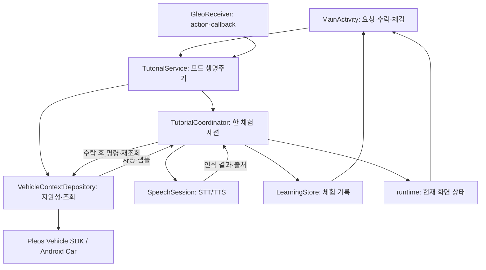
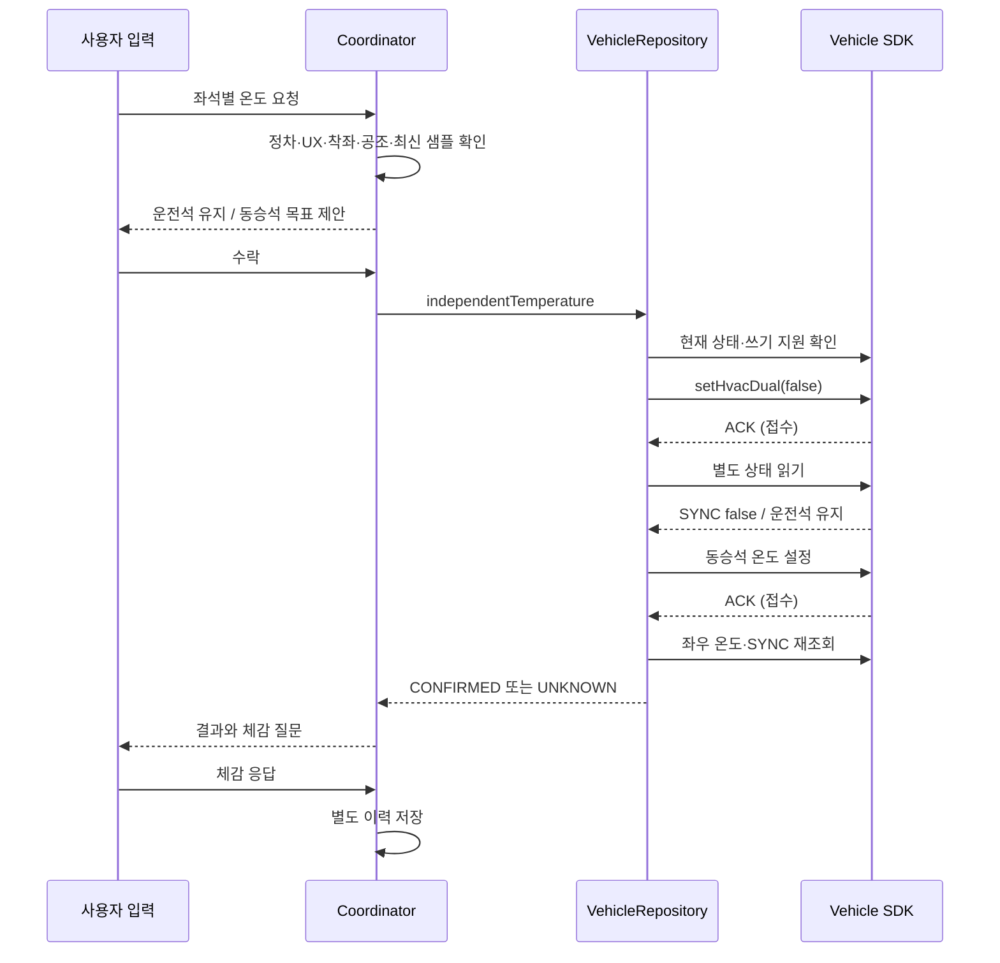

# 구조와 코드 읽기

## 전체 흐름

외부 서버 없이 차량 안에서 동작하는 앱입니다. Python 도구와 HTTP 콘솔은 PC에서 에뮬레이터 시험 상황을 만들며 APK에 포함되지 않습니다.

## 읽는 순서와 책임

| 순서 | 파일·주요 함수 | 읽을 질문 |
|---|---|---|
| 1 | [Models.kt](../android/app/src/main/java/kr/pleosguide/Models.kt): VehicleSample, ContextSnapshot, TutorialSession, Utterances | 값이 신선하고 안전한지 어떻게 판단하는가? |
| 2 | [TutorialCoordinator.kt](../android/app/src/main/java/kr/pleosguide/TutorialCoordinator.kt): start, input, sample, finish | 제안·수락·실행·피드백·취소를 어떻게 이어 가는가? |
| 3 | [VehicleContextRepository.kt](../android/app/src/main/java/kr/pleosguide/VehicleContextRepository.kt): probe, snapshot, independentTemperature | 지원성 확인과 실제 제어·재조회는 어디서 하는가? |
| 4 | [TutorialService.kt](../android/app/src/main/java/kr/pleosguide/TutorialService.kt): onCreate, onDestroy | 언제 연결하고 Off에서 무엇을 해제하는가? |
| 5 | [Stores.kt](../android/app/src/main/java/kr/pleosguide/Stores.kt): GuideApplication, LearningStore, EvidenceRecorder | 재시작 때 지울 상태와 남길 기록은 무엇인가? |
| 6 | [MainActivity.kt](../android/app/src/main/java/kr/pleosguide/MainActivity.kt): onCreate, render | 화면·설정·이력은 서비스와 어떻게 연결되는가? |
| 7 | [SpeechSession.kt](../android/app/src/main/java/kr/pleosguide/SpeechSession.kt), [GleoReceiver.kt](../android/app/src/main/java/kr/pleosguide/GleoReceiver.kt), [schema.json](../android/app/src/main/assets/schema.json) | 음성·외부 action 입력의 검증 경계는 어디인가? |

## SYNC: 접수와 성공을 구별하는 경로

VehicleSample은 값·시각·영역·단위·출처·지원성·오류를 함께 보관합니다. 5초보다 오래된 샘플, 3초를 넘는 묶음의 시간 차이, 미확인 기어·UX는 제어에 사용하지 않습니다. 현재 쓰기 경로는 SYNC와 동승석 목표온도입니다. 나머지 체험은 순정 조작 안내 또는 관측입니다.

## 한 세션의 생명주기

PROPOSED에서 수락을 받아 SYNC는 EXECUTING, 수동 조작 체험은 GUIDING, Gleo는 HANDED_OFF로 이동합니다. 확인된 SYNC 결과나 안내 단계 완료 후 FEEDBACK에서 응답을 기록합니다. 거절·취소·만료·조건 이탈은 finish로 종료하고 세션을 비웁니다. 일반 응답은 90초, Gleo 전달은 180초 만료입니다. 자동 명령 결과가 UNKNOWN이면 수동 안내로 이어집니다.

Service는 1초 간격으로 샘플을 읽고 30초마다 지원성을 다시 조사합니다. SDK 초기화·호출은 IO에서 수행하며 실제 주기는 응답 시간만큼 늘어날 수 있습니다. Off에서는 작업·음성·SDK를 해제합니다. START_NOT_STICKY로 서비스의 자동 재시작을 요청하지 않습니다.

## 재시작 때 무엇이 남는가

| 저장 위치 | 역할 | 새 프로세스 |
|---|---|---|
| runtime SharedPreferences | 모드·현재 문구·온도·화면 | GuideApplication.onCreate에서 초기화, 기본 Off |
| settings SharedPreferences | 다섯 기능별 안내 On/Off | 보존 |
| learning SharedPreferences | 제안 시각, 수락, 제어 결과, 체감·재사용 응답 | 보존 |
| files/evidence.jsonl | 출처·세션 ID·시각을 포함한 진단 | 보존, 약 8MB 초과 시 이전 파일로 회전 |

이력은 기능별 최근 기록이며 모든 과거 체험을 나열하는 무제한 타임라인은 아닙니다. 앱 삭제·데이터 지우기는 이력을 삭제합니다. 재시작 시험은 서명 release 화면의 이력 문자열과 다섯 체크박스 값을 비교합니다. 내부 저장소의 모든 타임스탬프 바이트를 추출해 대조하는 시험은 아닙니다.

## 시험 코드

- [GuideSafetyTest.kt](../android/app/src/test/java/kr/pleosguide/GuideSafetyTest.kt): 9개 안전 조건·값·의도 시험.
- [release_smoke.py](../tools/release_smoke.py): UI 수락·SDK 결과·Off·강제 종료 후 이력·설정 비교.
- [restart_persistence.py](../tools/restart_persistence.py): AVD 콜드 부팅과 모드 On에서 강제 종료 후 비교.
- [wait_vehicle_ready.py](../tools/wait_vehicle_ready.py): DDS 주소·활성 세션·브리지·공조 송수신 준비 확인.
- [exception_trial.py](../tools/exception_trial.py): debug 주입 기반 예외·백그라운드 시험. TestReceiver는 release에 없습니다.

관측된 성공과 미검증 항목은 [시험 결과](testing.md)를 기준으로 읽습니다.
